# Flag Edu 사용자 가이드

교육 워크스페이스의 수업·일정과 보고서를 관리하는 서비스입니다. 처음 사용하는 분은 **공통기능 → 코치 기능** 순서로 읽고, 관리자는 **관리자 기능**까지 이어서 확인하세요.

[서비스 열기](https://flag-edu-prototype.vercel.app) · [사용자 가이드 PDF 다운로드](docs/Flag-Edu-User-Guide.pdf) · [개발·운영 참고](docs/development.md)

**기준일: 2026년 10월 13일** · 운영 화면 기준

- [1. 개요 및 용어정리](#overview)
- [2. 공통기능 — 회원가입 및 로그인](#common)
- [3. 코치 기능](#coach)
- [4. 관리자 기능](#admin)

화면은 운영 서비스에 전용 QA 계정으로 접속해 캡처했습니다. 이름·이메일·워크스페이스 식별 정보는 문서용 예시로 바꾸었습니다. 모바일 화면 일부를 보여 주므로 아래쪽 항목은 스크롤해야 보일 수 있습니다. 건수·날짜·초대 유무는 계정에 따라 달라집니다. Chromium의 402×874 화면을 사용했으며 실물 휴대전화 캡처는 아닙니다.

## 1. 개요 및 용어정리

### 1.1 서비스 구조와 용어

업무는 **워크스페이스 → 수업 → 일정 → 보고서** 순서로 연결됩니다. 예를 들어 ‘플래그 교육’ 워크스페이스에서 ‘초등 체육’ 수업을 만들고, ‘10월 20일 수업’ 일정을 등록한 뒤 그날의 활동을 보고서로 작성합니다.

| 용어 | 의미 |
| --- | --- |
| 워크스페이스 | 함께 수업을 운영하는 팀 공간. 수업·일정·보고서·양식·참여자를 공간별로 관리합니다. |
| 수업 | 수업명, 장소·기관명, 진행방식과 메모 같은 기본정보입니다. |
| 일정 | 특정 날짜에 진행하는 수업입니다. 단일 일정이나 반복 일정을 등록할 수 있습니다. |
| 보고서 | 한 일정의 활동 내용과 사진을 작성자별로 기록한 문서입니다. |
| 보고서 양식·템플릿 | 보고서에 입력할 질문, 입력 유형, 필수 여부와 사진 수를 정한 틀입니다. |
| 임시저장 | 작성 중인 보고서를 저장한 상태. 필수 항목을 모두 채우지 않아도 저장할 수 있습니다. |
| 제출 | 필수 항목을 채워 제출한 상태. 별도의 관리자 승인 단계는 없습니다. |
| 받은 초대 | 다른 워크스페이스의 참여 요청입니다. 앱 안에서 수락·거절합니다. |

**온라인 연결이 필요합니다.** 휴대전화와 PC 브라우저에서 사용할 수 있으며, 지원 브라우저에서는 홈 화면에 추가해 앱처럼 열 수 있습니다.

### 1.2 권한과 참여 상태

권한은 **현재 선택한 워크스페이스**를 기준으로 적용됩니다. 같은 계정이 한 공간에서는 코치, 다른 공간에서는 관리자일 수 있습니다.

| 기능 | 코치 | 관리자 |
| --- | --- | --- |
| 현재 워크스페이스 수업·일정 조회 | 가능 | 가능 |
| 수업 기본정보·일정 등록 | 가능 | 가능 |
| 수업·일정 수정 및 일정 취소 | 본인이 등록한 항목 | 해당 공간의 전체 항목 |
| 보고서 조회·작성·수정, 사진 관리 | 본인 보고서 | 해당 공간의 전체 보고서 |
| 참여자·권한 조회, 본인 나가기 | 가능 | 가능 |
| 이름 변경·초대·참여자 권한 관리·워크스페이스 삭제 | 불가 | 가능 |
| 보고서 양식 관리·전체 보고서 다운로드 | 불가 | 가능 |
| 계정 정보·로그아웃·받은 초대 확인 | 가능 | 가능 |
| 새 워크스페이스 만들기 | 가능, 만든 공간의 관리자가 됨 | 가능 |

| 참여 상태 | 의미 |
| --- | --- |
| 참여 중 | 부여받은 권한으로 워크스페이스를 이용합니다. |
| 비활성 | 접근이 중지됩니다. 관리자 목록에는 남으며 다시 활성화할 수 있습니다. |
| 참여 종료 | 내보내기·나가기로 참여를 끝낸 상태. 참여자 목록에서 숨겨지며 다시 참여하려면 새 초대를 수락해야 합니다. |

기존에 숨겨졌던 참여자는 계속 숨김을 유지합니다. 비활성과 참여 종료는 앞으로 별도로 관리합니다.

## 2. 공통기능 — 회원가입 및 로그인

### 2.1 Google 회원가입과 기존 계정 로그인

1. [Flag Edu](https://flag-edu-prototype.vercel.app)에 접속합니다.
2. **Google로 가입·로그인**을 누르고 사용할 Google 계정을 선택합니다.
3. 처음 가입하는 경우 **[필수] 이용약관 동의**, **[필수] 개인정보 수집·이용 동의** 내용을 확인합니다.
4. 두 항목을 체크하고 **동의하고 가입 완료**를 누릅니다.

새 회원가입은 Google 계정으로 진행합니다. 이메일 인증코드를 입력하거나 별도 비밀번호를 만드는 단계는 없습니다. 마케팅 동의도 받지 않습니다. Google 계정 선택 화면은 Google에서 제공합니다.

이미 이메일·비밀번호 계정을 사용하고 있다면 아래의 **기존 이메일 계정으로 로그인**에서 로그인하세요. 비밀번호를 잊었을 때는 **비밀번호를 잊으셨나요?**를 사용합니다. 복구 메일이 오지 않으면 스팸함을 확인한 뒤 운영자에게 문의하세요.

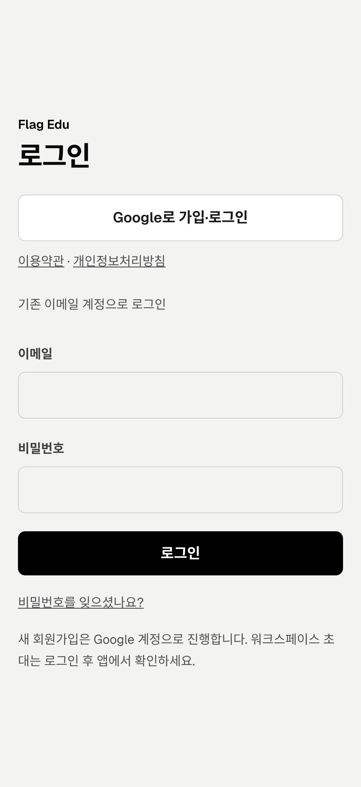

### 2.2 처음 시작하기와 소속 없는 계정

가입 후 참여한 워크스페이스가 없다면 시작 화면이 열립니다.

- 초대받았다면 **받은 초대**에서 워크스페이스를 확인하고 수락합니다.
- 새 팀을 운영한다면 이름을 입력하고 **워크스페이스 만들기**를 누릅니다. 만든 사람은 해당 공간의 관리자가 됩니다.
- 아직 초대가 없어도 **계정 관리**에서 내 정보를 확인하고 로그아웃할 수 있습니다.

초대가 보이지 않으면 관리자에게 **실제로 로그인한 계정의 이메일**로 초대했는지 확인해 달라고 요청하세요. 아래 화면은 받은 초대가 없는 예시입니다.

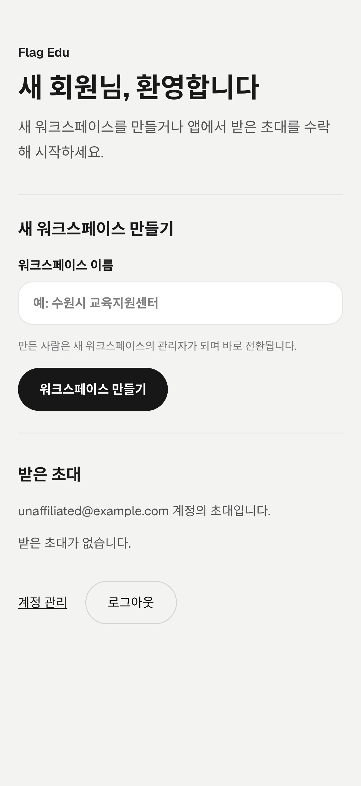
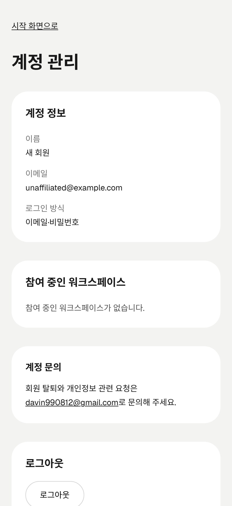

### 2.3 워크스페이스 전환과 초대 수락

1. 상단의 **현재 워크스페이스 이름**을 누릅니다.
2. 참여 중인 공간과 내 권한을 확인하고, 이동할 워크스페이스를 선택합니다.
3. 초대는 이 팝업 또는 **관리 → 워크스페이스·참여자 → 받은 초대**에서 확인합니다.
4. 초대가 있으면 이름과 수락 기한을 확인한 뒤 **수락** 또는 **거절**합니다. 수락하면 해당 공간의 코치로 참여합니다.

**초대 메일은 발송되지 않습니다.** 초대받은 이메일과 동일한 계정으로 앱에 로그인해야 합니다. 별도의 상단 ‘받은 초대’ 버튼은 없습니다.

워크스페이스를 전환하면 수업·일정·보고서의 조회 범위가 함께 바뀝니다. 다른 탭에도 전환이 반영되므로, 작성 중인 보고서는 먼저 저장하세요. 다른 탭에서 전환되었을 때 미저장 입력은 자동 저장하지 않습니다.

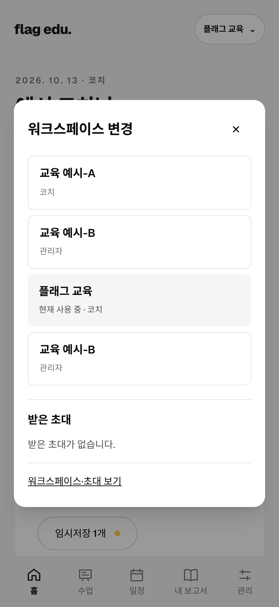
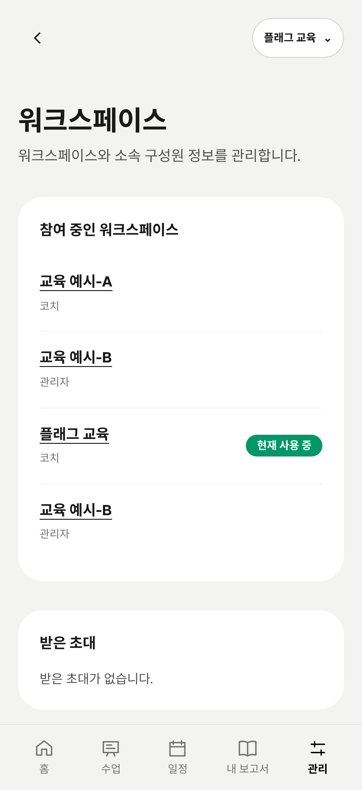

### 2.4 계정 확인과 로그아웃

**관리 → 계정 관리**에서 이름, 이메일, 로그인 방식과 참여 중인 워크스페이스별 권한을 확인합니다. 상단의 별도 계정 버튼 대신 이 메뉴를 사용하세요.

1. 계정 관리 화면 아래의 **로그아웃**을 누릅니다.
2. **정말로 로그아웃하시겠습니까?**라는 확인창에서 **로그아웃**을 누르면 종료됩니다.
3. 계속 사용하려면 **취소**를 누릅니다.

회원 탈퇴와 개인정보 관련 요청은 **davin990812@gmail.com**으로 문의하세요. 현재 계정 화면에서 직접 탈퇴하는 기능은 제공하지 않습니다.

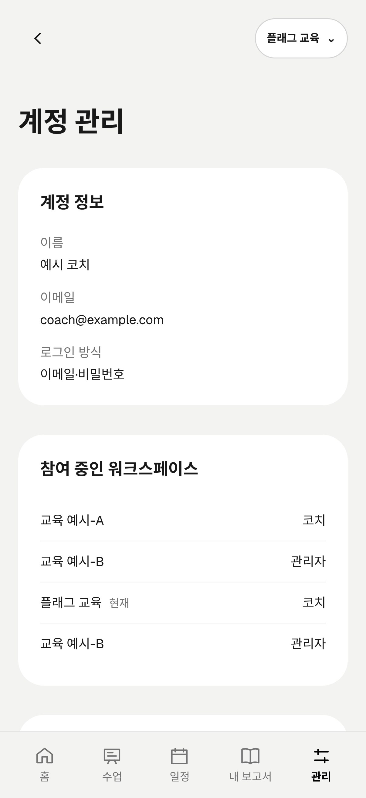
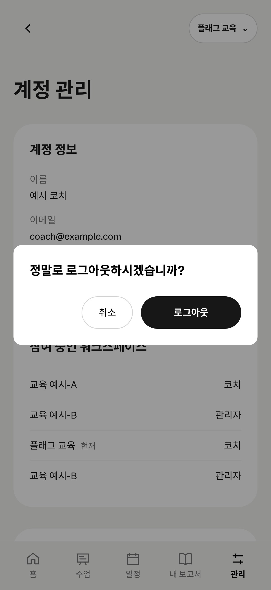

## 3. 코치 기능

### 3.1 홈에서 오늘 할 일 확인

**홈**에서 가까운 수업 일정, 임시저장 보고서와 최근 기록을 확인합니다. **수업 확인 · 기록하기**를 누르면 일정 상세로 이동합니다.

하단 메뉴의 **수업**, **일정**, **내 보고서**를 사용하면 원하는 업무로 바로 이동할 수 있습니다. 항상 상단의 워크스페이스 이름을 먼저 확인하세요.

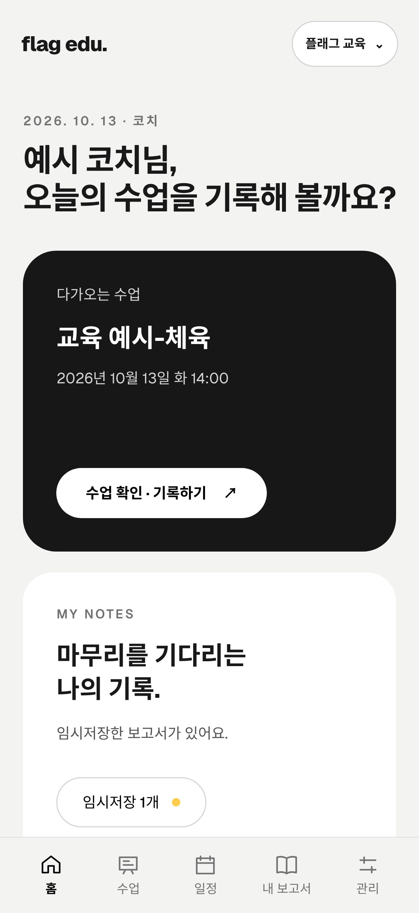

### 3.2 수업 기본정보 등록

1. **수업 → 수업 등록**으로 이동합니다.
2. **수업명**, **장소 또는 기관명**을 입력합니다.
3. 필요한 경우 진행방식과 메모를 작성합니다.
4. **수업 등록**을 눌러 저장합니다.

수업 기본정보를 한 번 등록하면 여러 일정에서 반복해서 사용할 수 있습니다. 코치는 본인이 등록한 수업을 수정할 수 있습니다. 실제 수업 날짜는 다음 단계에서 별도로 등록합니다.

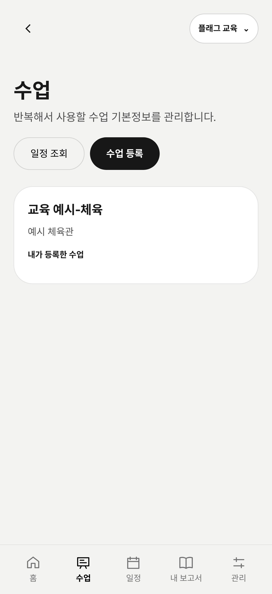
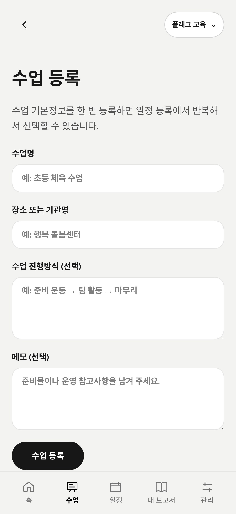

### 3.3 일정 조회와 필터

**일정**에서 **목록** 또는 **캘린더**를 선택합니다.

- 목록에서는 날짜별 수업, 장소, 상태와 시간을 확인합니다. 기본 정렬은 최신순입니다.
- **필터**를 열면 시작일·종료일·상태·정렬 조건을 바꿀 수 있습니다. **필터 초기화**는 날짜를 비우고 상태 전체·최신순으로 되돌립니다.
- 캘린더에서는 월을 이동하고 날짜를 눌러 해당 날짜의 일정을 확인합니다.
- 시간을 정하지 않은 일정은 **시간 미정**으로 표시됩니다. 날짜와 시간은 한국 시간 기준입니다.

일정을 누르면 상세 정보와 보고서 작성·조회 링크를 볼 수 있습니다. 취소된 일정은 기록 조회용으로 남습니다.

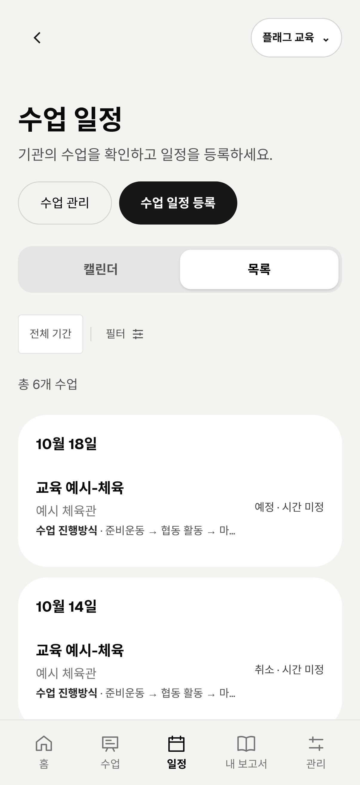
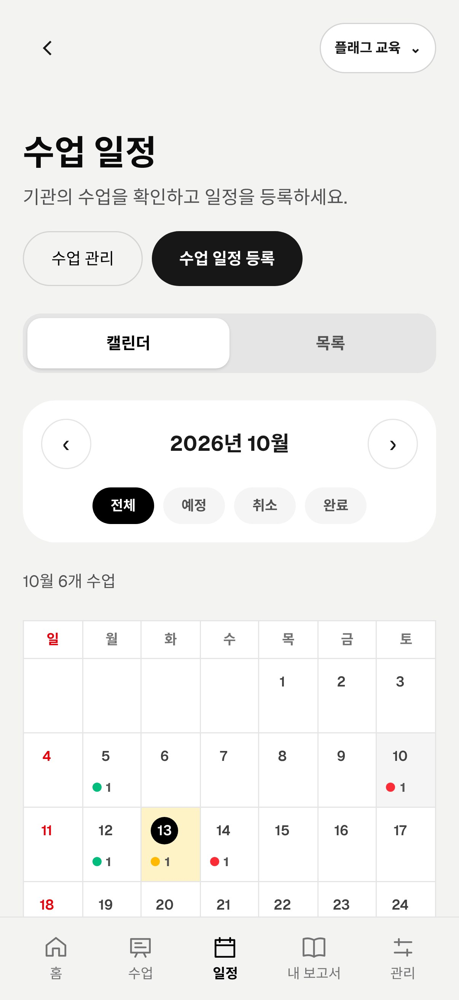
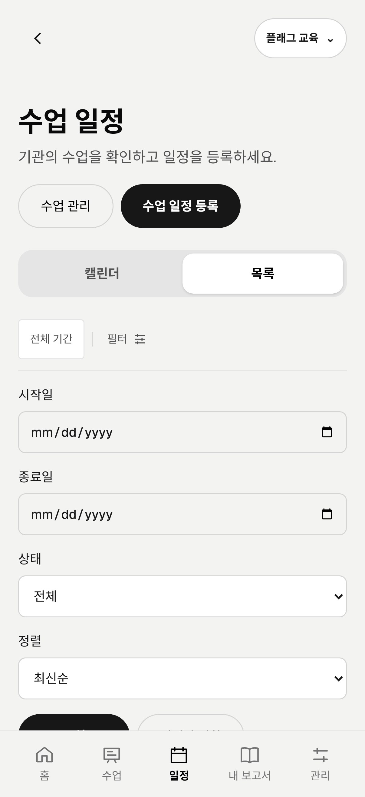

### 3.4 단일·반복 일정 등록

1. 수업 상세 또는 일정 화면에서 **일정 등록**으로 이동합니다.
2. **수업을 선택해 주세요.** 단계에서 등록해 둔 수업을 선택합니다.
3. **다음**을 눌러 날짜, 시간 지정 여부와 반복 조건을 설정합니다.
4. 마지막 확인 단계에서 생성할 날짜들을 검토하고 등록을 완료합니다.

한 번만 진행하거나 일·주·월 단위로 반복하도록 설정할 수 있습니다. 시간을 지정하면 시작·종료 시간을 함께 확인하세요. 코치는 본인이 등록한 일정을 수정·취소할 수 있습니다. **취소된 일정의 보고서는 수정·제출하거나 사진을 변경할 수 없습니다.**

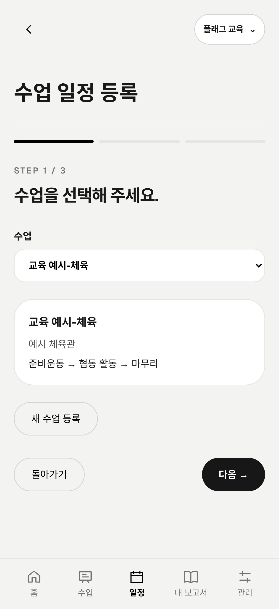
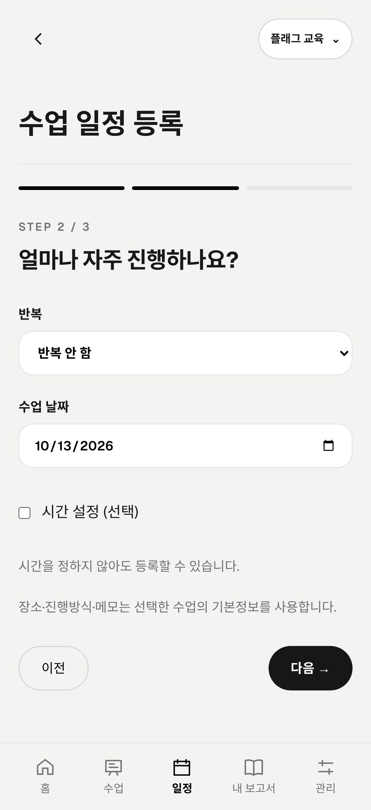

### 3.5 보고서 작성·임시저장·제출

작성 흐름은 **일정 상세 → 보고서 작성 → 답변·사진 입력 → 임시저장 또는 제출**입니다. 기존 보고서는 **내 보고서 → 보고서 선택 → 수정**으로 다시 작성합니다.

1. 관리자가 정한 양식에 맞춰 답변을 입력합니다.
2. 작성 중이면 **임시저장**합니다. 필수 항목이 비어 있어도 저장할 수 있습니다.
3. 작성을 마쳤으면 필수 답변·사진을 확인하고 **제출**합니다.
4. 제출한 내용을 수정·저장하거나 사진을 바꾸면 임시저장 상태로 돌아갑니다. 완료 후 다시 제출하세요.

코치는 본인 보고서만 조회·수정합니다. 보고서 양식이 없으면 관리자에게 양식 게시를 요청하세요. 다른 화면에서 이미 수정한 보고서는 덮어쓰지 않고 안내가 나타납니다. 현재 입력을 따로 보관한 뒤 새로고침해 최신 내용을 확인하세요.

아래 상세 화면은 **취소된 일정의 보고서를 조회하는 예시**입니다. 답변은 남아 있고 수정 버튼은 표시되지 않습니다. 정상 일정에서는 수정으로 들어갈 수 있습니다.

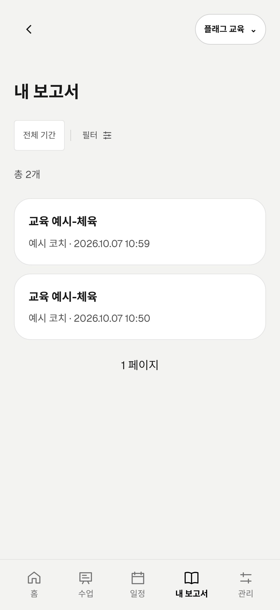
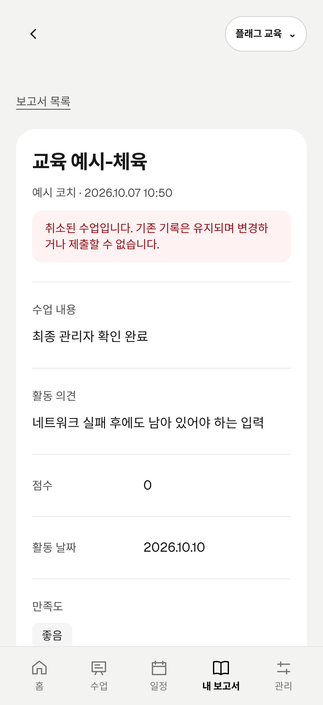

### 3.6 보고서에 사진 첨부

보고서 수정 화면의 사진 항목에서 **사진 추가**를 눌러 사진을 선택합니다. 여러 장을 선택할 수 있으며 항목별 허용 장수를 넘지 않아야 합니다.

- 브라우저가 읽을 수 있는 **25MiB 이하**의 원본 이미지를 선택합니다. 앱이 크기를 줄인 뒤 업로드합니다.
- 사진 업로드·삭제는 **본문 임시저장과 별도로 즉시 반영**됩니다. 사진 처리가 끝난 다음 본문을 저장하거나 제출하세요.
- 여러 장 업로드 중 일부가 실패하면 성공한 사진은 남습니다. 실패한 사진만 다시 선택하세요.
- 썸네일을 누르면 확대해서 볼 수 있습니다. 가로로 긴 사진 목록은 좌우로 스크롤합니다.
- 삭제할 사진은 삭제 버튼을 누른 뒤 확인창에서 결정합니다.

아래는 취소된 일정에 보존된 단색 테스트 이미지의 조회 예시입니다. 취소된 일정에서는 사진을 추가·삭제할 수 없습니다. HEIC 등은 기기·브라우저에 따라 읽지 못할 수 있으므로 필요하면 JPEG로 변환해 주세요.

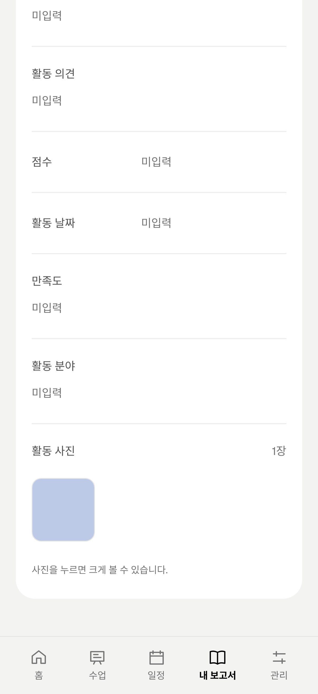

### 3.7 미저장 보고서 보호

보고서 답변을 바꾼 상태에서 앱 메뉴, 앱의 뒤로가기 버튼 또는 워크스페이스 전환을 사용하면 이동 여부를 확인합니다.

| 선택 | 결과 |
| --- | --- |
| 계속 작성 | 이동을 취소하고 현재 입력을 유지합니다. |
| 저장하지 않고 이동 | 미저장 답변을 버리고 이동합니다. 이미 반영된 사진 변경은 되돌리지 않습니다. |
| 저장·사진 처리 중 | 처리가 끝날 때까지 기다린 후 이동합니다. |

이 확인창이 **자동 저장을 의미하지는 않습니다.** 브라우저 자체의 뒤로가기·모바일 뒤로가기 제스처까지 같은 확인창이 뜨는 것은 아니므로, 중요한 내용은 이동 전에 **임시저장**하세요. 새로고침·탭 닫기에서는 브라우저가 자체 경고를 표시할 수 있습니다.

### 3.8 참여자 확인과 워크스페이스 나가기

**관리 → 워크스페이스·참여자 → 워크스페이스 이름**을 선택하면 **참여자·권한** 목록을 확인합니다. 옆의 **?** 버튼을 누르면 역할 안내가 열립니다.

본인 행에는 **나가기**가 표시됩니다. 나가기를 확인하면 해당 공간의 참여가 종료되고 접근할 수 없게 됩니다. 계정과 다른 워크스페이스의 참여는 유지됩니다. 다시 참여하려면 관리자에게 새 초대를 요청하세요.

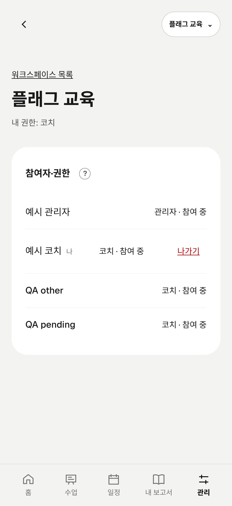

## 4. 관리자 기능

### 4.1 관리 메뉴 구성

관리자는 코치 기능에 더해 현재 워크스페이스의 전체 업무를 관리할 수 있습니다. **관리** 메뉴는 다음 세 묶음으로 구성됩니다.

| 묶음 | 메뉴 | 하는 일 |
| --- | --- | --- |
| 계정 | 계정 관리 | 내 정보, 로그인 방식, 소속 확인과 로그아웃 |
| 워크스페이스 | 워크스페이스·참여자 | 공간별 참여자·권한·초대·이름·삭제 관리 |
| 보고서 관리 | 전체 보고서 / 보고서 양식 / 보고서 다운로드 | 전체 기록 조회, 양식 구성, PDF·Excel 내보내기 |

보고서 관리는 워크스페이스 관리와 별도 메뉴로 제공됩니다. 작업 전에 상단에서 대상 워크스페이스를 확인하세요.

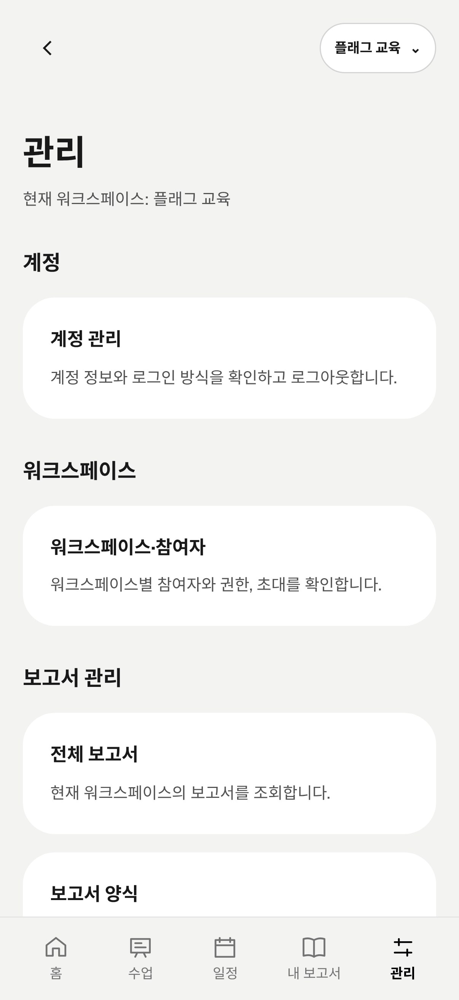

### 4.2 워크스페이스 생성·이름 변경

새 공간은 **관리 → 워크스페이스·참여자 → 새 워크스페이스**에서 이름을 입력하고 만듭니다. 이름은 2~100자로 입력합니다. 생성 즉시 새 공간의 관리자로 전환됩니다.

이름을 변경하려면 다음 순서로 진행합니다.

1. 워크스페이스 목록에서 이름을 눌러 상세를 엽니다.
2. **워크스페이스 이름 변경**을 펼칩니다.
3. 새 이름을 입력하고 **이름 저장**을 누릅니다.

해당 워크스페이스의 관리자에게 이름 변경 기능이 표시됩니다.

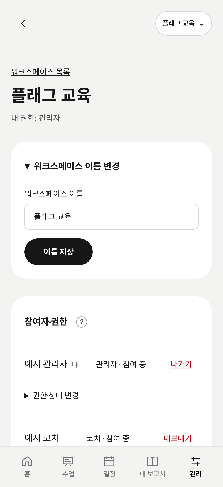

### 4.3 참여자 권한·비활성·내보내기

워크스페이스 상세의 **참여자·권한**에서 대상 참여자의 **권한·상태 변경**을 펼칩니다. 역할과 상태를 선택하고 **변경 확인**을 체크한 뒤 **적용**합니다. 초대와 권한 변경을 하려면 먼저 상단에서 해당 워크스페이스로 전환해야 합니다.

- **역할:** 관리자 또는 코치로 변경합니다.
- **비활성:** 해당 공간의 접근만 중지합니다. 관리자 목록에 남고, 다시 **참여 중**으로 바꿀 수 있습니다.
- **내보내기:** 참여를 종료하고 목록에서 숨깁니다. 비활성인 참여자도 내보낼 수 있습니다. 복귀하려면 새 초대가 필요합니다.
- **나가기:** 본인 행에서는 내보내기 대신 이 문구를 사용합니다.

마지막 활성 관리자를 코치로 바꾸거나 비활성화·내보내기·나가기로 제거할 수 없습니다. 먼저 다른 참여자에게 관리자 역할을 부여하세요. 본인 상태는 이 폼에서 비활성으로 바꿀 수 없습니다.

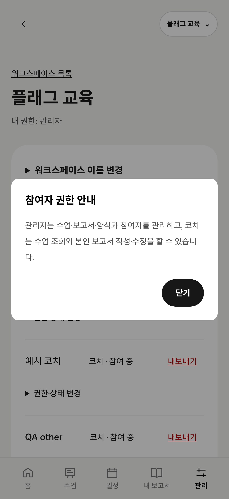

### 4.4 앱 안에서 참여자 초대

초대는 별도 관리 메뉴가 아니라 **워크스페이스 상세 → 참여자·권한** 아래에서 관리합니다.

1. **워크스페이스 초대**에 상대방이 로그인할 이메일을 입력합니다.
2. 초대를 등록하고 **보낸 초대**에서 상태를 확인합니다.
3. 상대방에게 앱에 로그인해 **받은 초대**를 확인하라고 알려 주세요.
4. 상대방이 수락하면 코치로 참여합니다. 관리자 권한이 필요하면 수락 후 변경하세요.

미가입자도 이메일로 초대를 등록해 둘 수 있습니다. 초대만으로 계정이나 참여가 만들어지지는 않습니다. 메일은 발송되지 않습니다. 수락 대기 초대는 취소할 수 있고, 거절·취소·만료된 경우 다시 초대할 수 있습니다. 비활성 참여자는 초대로 우회 복귀시키지 말고 상태를 **참여 중**으로 변경하세요.

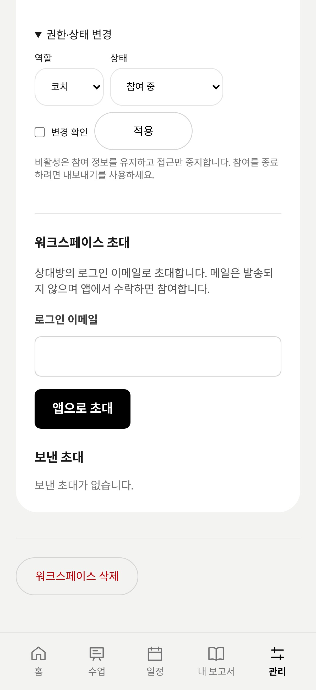

### 4.5 전체 보고서 조회·수정

**관리 → 전체 보고서**에서 현재 워크스페이스의 모든 작성자 보고서를 확인합니다. 기간·작성자·수업으로 조회 범위를 좁힌 뒤 보고서를 선택하세요.

관리자는 해당 공간의 보고서 답변과 사진을 수정하고 제출할 수 있습니다. 저장·제출·사진 처리 방법은 코치 기능과 같습니다. 취소된 일정의 보고서는 관리자도 조회만 할 수 있습니다.

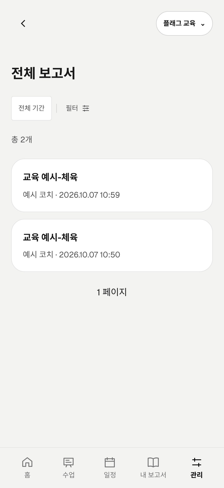

### 4.6 보고서 양식 만들기와 변경

**관리 → 보고서 양식**에서 화면의 **새 템플릿**을 누릅니다. 기존 양식은 **조회 / 수정** 또는 **수정**으로 엽니다.

1. 양식 이름을 정하고 **항목 추가**를 누릅니다.
2. 항목명, 입력 유형, 도움말과 필수 여부를 설정합니다.
3. 선택형 항목은 선택지를 추가하고, 사진 항목은 최대 사진 수를 정합니다.
4. **위로 / 아래로**로 순서를 바꾸고 **미리보기**로 입력 형태를 확인합니다.
5. 준비 중이면 **임시 저장**합니다. 새 보고서에 사용할 때는 게시 확인을 체크하고 **수정 완료**를 누릅니다.

짧은 글·긴 글·숫자·날짜·단일 선택·복수 선택·사진을 지원하며, 최대 50개 항목을 구성할 수 있습니다. **사용 중** 배지로 현재 게시된 양식을 확인하세요. 양식을 수정해도 기존 보고서는 작성 당시 구조를 유지합니다. 양식 삭제는 목록과 새 작성에서 숨기는 방식으로, 기존 보고서를 지우지 않습니다.

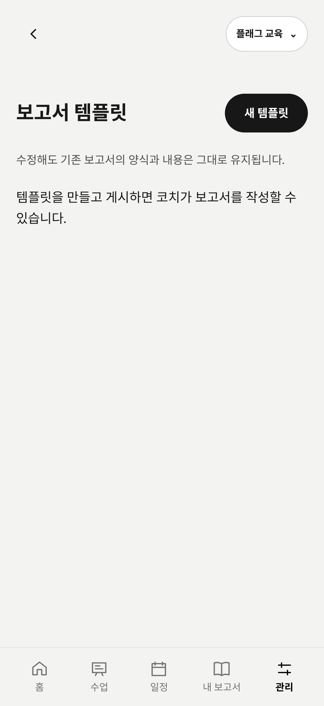
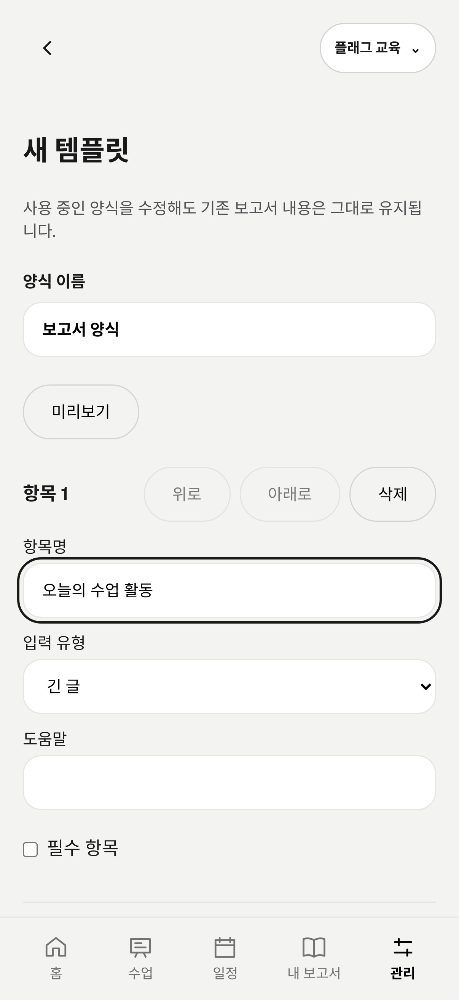

### 4.7 보고서 PDF·Excel 다운로드

1. **관리 → 보고서 다운로드**를 엽니다.
2. 수업 시작일·종료일, 작성자와 수업으로 범위를 선택합니다.
3. 파일 형식을 **Excel (.xlsx)** 또는 **PDF**로 선택합니다.
4. **생성 및 다운로드**를 누르고 생성이 끝날 때까지 기다립니다.

한 번에 최대 **200개 보고서**를 내보낼 수 있습니다. PDF는 사진을 포함하며 원본 사진 합계가 **100MiB 이하**여야 합니다. 한도를 넘으면 기간이나 수업 범위를 나누세요. 일부 사진을 읽지 못하면 PDF에 안내가 표시될 수 있으니 공유 전에 확인하세요.

파일은 생성 즉시 기기로 다운로드됩니다. **서버에 다운로드 파일을 보관하지 않으므로** 필요한 파일은 직접 저장하세요. 이 기능은 업무 보고서를 내보내는 기능이며, 이 문서 상단의 사용자 가이드 PDF와는 별개입니다.

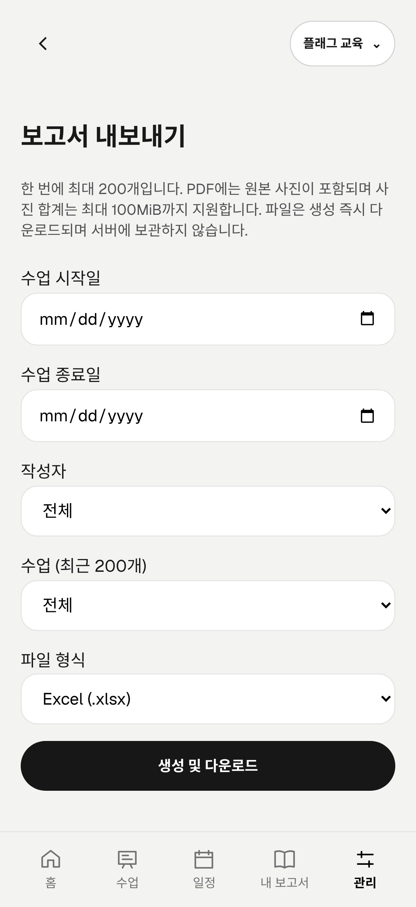

### 4.8 워크스페이스 삭제

1. 삭제할 워크스페이스의 상세를 엽니다.
2. 맨 아래 **워크스페이스 삭제**를 누릅니다.
3. 팝업에 표시된 **현재 워크스페이스 이름을 정확하게 입력**합니다.
4. 이름이 일치해 활성화된 **삭제 확인**을 누릅니다. 진행하지 않으려면 **취소**합니다.

삭제하면 모든 참여자의 접근이 종료되고 일반 화면에서 사라집니다. 회원 계정과 다른 워크스페이스의 참여는 유지됩니다.

수업·보고서·사진은 **삭제 후 30일간 보관한 뒤 영구 삭제**됩니다. 복구가 필요하면 30일 이내에 **davin990812@gmail.com**으로 문의하세요. 화면에서 직접 복구하는 기능은 없습니다.

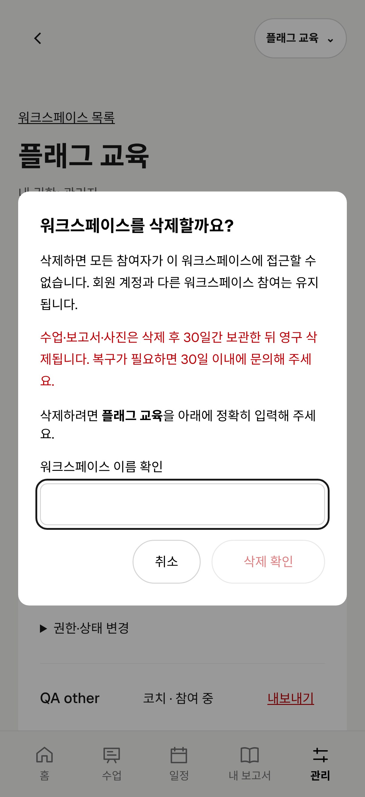

---

문서 및 PDF 생성 방법: [가이드 생성 안내](docs/user-guide-build.md) · 화면 기준과 무결성 정보: [캡처 기록](docs/images/guide-manifest.json)
